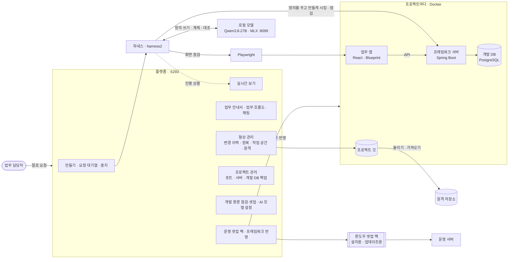
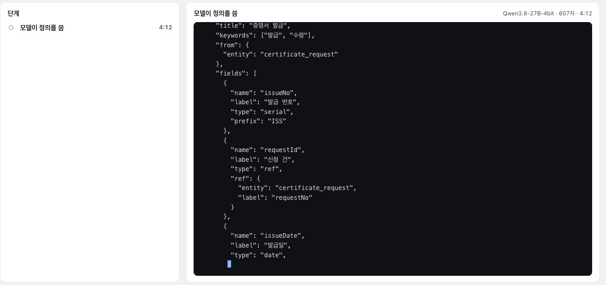
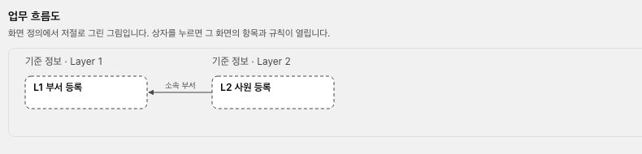
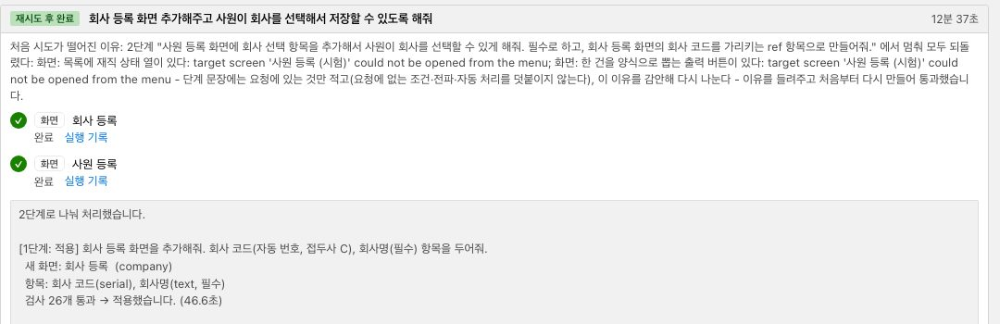

# Local Workshop

**말로 업무 화면을 만드는 플랫폼입니다. 맥 한 대에서 도는 로컬 모델로요.**

요청창에 이렇게 적으면 됩니다.

> 동호회 가입 신청 화면 만들어줘. 이미 들어 있는 동호회에 또 신청하면 안 돼.

몇 분 뒤에는 조회·등록·수정·이력·권한까지 갖춘 화면이 업무 앱에 생겨 있습니다. 같은 사람이 같은 동호회에 두 번 신청하면 저장이 거절되는 것도 확인을 마친 상태입니다.

외부 AI API는 쓰지 않습니다. 모델은 Qwen3.8-27B(4bit)이고, 32GB 맥 미니에서 MLX로 돌립니다.


---

## 왜 이렇게 만들었나

처음에는 로컬 모델에게 화면 코드를 직접 쓰게 했습니다. 잘 안 됐습니다. 화면 하나를 고치는 데 수십 번을 오갔고, 한 곳을 고치면 다른 곳이 깨졌습니다.

그래서 거꾸로 갔습니다. **모델에게 맡기는 일을 최대한 줄였습니다.**

- 모델은 코드를 쓰지 않습니다. 화면마다 정해진 모양의 **정의(JSON)** 하나만 씁니다.
- 테이블, API, 권한, 이력, 화면 배치 같은 세밀한 일은 **프레임워크**가 합니다.
- 모델이 "다 됐습니다"라고 해도 믿지 않습니다. **하네스**가 직접 저장해 보고, 화면을 눌러 보고, 업무를 처음부터 끝까지 돌려 본 뒤에만 반영합니다.

약한 모델에게는 큰 자유도, 섬세한 솜씨도 기대하지 않는 게 핵심입니다. 모델은 업무의 뜻을 판단하는 일만 합니다. 어떤 항목이 필요한지, 기준 정보인지 업무 기록인지, 어느 화면을 가리키는지 같은 것들입니다.

## 누가 무엇을 하나

일을 넷으로 나눴습니다.

- **로컬 모델 (기획)** — 요청을 읽고 화면 정의를 씁니다. 하네스가 물으면 자기 계획과 결과를 원래 요청과 맞춰 보기도 합니다.
- **하네스 (품질)** — 모델이 쓴 정의를 프레임워크에 주고 만들게 시킨 뒤, 직접 해 보고 판정합니다. `harness2/`
- **프레임워크 (개발자)** — 하네스가 시키는 대로 정의를 받아 테이블·API·화면을 만듭니다. 업무는 모르고 기능만 압니다. `platform/base/`
- **사람 (결정)** — 무엇을 만들지 말하고, 결과를 보고, 마음에 안 들면 원복합니다.

이 넷을 한 화면에 묶은 것이 **플랫폼**입니다. `platform/`

## 요청 하나가 지나가는 길

1. 요청이 들어오면 모델이 계획을 세웁니다. 화면이 여럿 필요하면 한 화면씩 나눕니다.
2. 하네스가 그 계획이 요청에 없는 걸 지어내지 않았는지 봅니다. ("09:00 넘으면 지각" 같은 규칙을 혼자 덧붙이는 일이 실제로 있었습니다.)
3. 모델이 정의를 씁니다. 프레임워크가 모양과 규칙을 판정하고, 틀리면 이유를 붙여 돌려보냅니다.
4. 하네스가 메뉴에 안 보이는 **시험용 정의**로 저장·조회·규칙·한도를 해 보고, 브라우저(Playwright)로 화면을 열어 눌러 봅니다.
5. 통과하면 게시합니다. 다른 화면과 얽힌 규칙과 업무 흐름은 게시본으로 다시 확인합니다.
6. 마지막으로 원래 요청과 한 번 더 맞춰 봅니다. 빠진 게 있으면 반영하지 않습니다.
7. 적용되면 프로젝트의 깃에 기록이 남고, 언제든 원복할 수 있습니다.

중간에 실패하면 그 요청이 만든 것을 되돌립니다. 업무 흐름이나 요청 대조에서 걸렸다면 그 이유를 모델에게 알려 주고 한 번 더 만들게 합니다. 그렇게 통과하면 기록에 **"재시도 후 완료"** 로 남습니다.

## 화면 정의는 이렇게 생겼습니다

```json
{ "title": "출퇴근 등록", "kind": "work",
  "fields": [
    { "name": "empId",    "label": "사원",     "type": "ref",
      "ref": { "entity": "employee", "label": "name" }, "required": true },
    { "name": "workDate", "label": "근무일",   "type": "date", "required": true },
    { "name": "clockIn",  "label": "출근 시각", "type": "time", "required": true }
  ] }
```

이걸 저장하면 바로 화면이 생깁니다. 빌드나 배포 과정은 없습니다. 기록을 저장하는 화면은 자기 테이블(`r_<key>`)과 이력 테이블(`h_<key>`)을 갖고, 공통 API와 화면 부품이 정의를 읽어 동작합니다.


정의에는 항목 말고도 여러 부품을 적을 수 있습니다. 상태와 상태 버튼, 다른 자료와 얽힌 금지 규칙, "출하는 수주를 넘을 수 없다" 같은 한도, 등록하면 따라 일어나는 일 등입니다. 앞 단계에서 남은 걸 골라 다음 단계를 만드는 연계 화면, 집계·현황판·달력·트리 화면, 출력 양식도 있습니다. 전체 목록과 설명은 모델이 읽는 그대로 [`AppDefinitions.java`](platform/base/backend/src/main/java/com/example/localinventory/framework/app/AppDefinitions.java)에 있습니다.

로그인, 사용자·역할·메뉴·권한 관리, 공통 코드, 접속 기록, 게시판, 마감은 처음부터 들어 있습니다.

## 플랫폼에서 할 수 있는 것



**요청하고 지켜보기.** 「만들기」에서 요청을 보내면 대기열에 줄을 섭니다. 「실시간 보기」에서는 모델이 입력을 얼마나 읽었는지, 어떤 정의를 쓰고 있는지가 한 글자씩 보이고, 점검이 하나씩 쌓입니다. 이상하면 중지 버튼으로 바로 멈출 수 있습니다.

**만든 걸 이해하기.** 「업무 안내서」는 정의를 읽어 업무 설명을 저절로 써 줍니다. 기준 정보의 층(Layer), 지시와 실적, 어느 화면이 무엇으로 이어지는지 같은 내용입니다. 「업무 흐름도」는 그걸 그림으로 그립니다. 화살표는 "이 화면이 저 화면을 가리킨다"는 뜻입니다. 채팅에서는 프로젝트에 대해 물어볼 수 있습니다.

**형상 관리.** 프로젝트마다 깃 저장소가 따로 있지만, 깃을 몰라도 쓸 수 있게 쉬운 말로 감쌌습니다.

- 요청이 적용될 때마다 저절로 기록됩니다. 사람이 손으로 고친 건 「무엇을 바꿨나요?」에 적고 「기록하기」를 누르면 됩니다.
- 기록마다 무엇이 바뀌었는지, 모델과 무엇을 주고받았는지 볼 수 있습니다.
- 「이 변경 취소하기」로 특정 변경만 되돌립니다.
- 「작업 공간」을 새로 만들어 시험해 보고 돌아올 수 있습니다. 깃으로 치면 브랜치입니다.
- 원격 저장소(GitHub 등)를 연결하고 「원격에 올리기」로 올립니다.

**프로젝트와 환경.** 프로젝트 만들기·이름 바꾸기·지우기, 포트 정하기, 서버 켜고 끄기, 개발 DB 백업과 백업에서 되돌리기를 모두 「설정 › 프로젝트」에서 합니다. 「개발 환경」은 도커·DB·Node·점검용 브라우저·모델 서버가 준비됐는지 보고, 없으면 버튼으로 깔아 줍니다. 「AI 모델」에서는 쓸 모델을 바꾸고 연결을 확인합니다.

**내보내기.** 다 만든 앱은 윈도우용 **셋업 팩**으로 나갑니다(아래). 프레임워크가 바뀌면 모든 프로젝트에 함께 반영하고 다시 점검합니다.

**개발자 도구.** 화면 정의와 저장된 자료와 서버 로그, 요청별 실행 기록, 통계, 프로젝트 소스를 볼 수 있습니다.

<table>
<tr><td></td><td></td></tr>
<tr><td align="center">처음 화면</td><td align="center">실시간 보기</td></tr>
<tr><td></td><td></td></tr>
<tr><td align="center">업무 흐름도</td><td align="center">요청 기록 — 재시도 후 완료</td></tr>
</table>

## 시작하기

**필요한 것:** Apple Silicon 맥(메모리 32GB 이상), Docker, Node.js, Python 3.9 이상. 모델 서버는 `~/.local/share/mlx-server/venv`에 `mlx_lm`이 깔려 있다고 가정합니다.

```sh
git clone https://github.com/igkrap/harness101-local.git
cd harness101-local

bash platform/scripts/qwen-serve-forever.sh &     # 로컬 모델 서버 (8099), 죽으면 다시 띄움
cd platform/web && npm ci && npm run build && cd ..
python3 server.py                                 # http://127.0.0.1:5293
```

`Local Workshop.command`를 두 번 눌러도 됩니다. 꺼져 있는 것들을 켜고 플랫폼을 앱 창으로 엽니다.

처음 열면 프로젝트가 하나도 없습니다. **개발 환경 점검 → 새 프로젝트 만들기 → 요청** 순서로 시작하면 됩니다.

> 모델 서버가 몇 시간마다 메모리 부족으로 죽는다면: `mlx_lm` 서버는 순차 처리일 때 `--prompt-cache-bytes`를 지키지 않습니다. 이 환경에서는 `mlx_lm/server.py`의 `LRUPromptCache`에 `max_bytes`를 넘기도록 고쳐 쓰고 있습니다. `mlx_lm`을 올리면 다시 고쳐야 합니다.

### 명령줄로도 됩니다

화면에서 하는 일은 `platform/ctl.py`로도 할 수 있습니다.

```sh
cd platform
python3 ctl.py create my-erp "우리 회사 업무"
python3 ctl.py -p my-erp ask "사원 등록 화면 만들어줘"
python3 ctl.py -p my-erp log            # 변경 이력
python3 ctl.py -p my-erp undo           # 마지막 변경 원복
python3 ctl.py -p my-erp pack           # 셋업 팩 만들기
```

전체 명령은 `python3 ctl.py -h`로 볼 수 있습니다.

## 운영으로 내보내기

운영 서버는 인터넷도 도커도 없는 윈도우라고 가정했습니다. 그래서 팩을 두 가지로 만듭니다.

- **설치용**: Java 런타임과 PostgreSQL을 함께 담고, 윈도우 서비스까지 등록합니다.
- **업데이트용**: 앱만 바꿉니다. 먼저 백업하고, 실패하면 원래대로 돌아갑니다.

팩은 운영 쪽의 자료·사용자·권한을 건드리지 않습니다. 플랫폼에는 항상 현재 판만 남습니다. 단, 윈도우 스크립트는 아직 맥에서 문법 검사만 했습니다.

## 폴더 구성

```
platform/        플랫폼 서버(server.py), 화면(web/), 명령줄(ctl.py), 셋업 팩
platform/base/   프레임워크 원본 — Spring Boot 백엔드 + React·Blueprint 화면
harness2/        하네스 — run.py(흐름), define.py(모델), checks.py(점검), flows.py(업무 흐름 시험)
erp-harness/     브라우저 화면 검사기 (코드 작성기 시절 파일이 일부 남아 있음)
projects/        플랫폼에서 만든 프로젝트 (저장소에는 안 들어감)
```

## 바탕이 된 생각들

새로운 이론을 만든 건 아닙니다. 이미 있는 생각들을 약한 모델에 맞게 엮었습니다.

- **그래프 이론** — 화면은 노드, 다른 화면을 가리키는 항목은 방향 간선입니다. Layer는 가장 깊은 의존의 깊이, 삭제 제한은 "가리키는 화면이 있는가", 업무 흐름은 그래프 위의 경로입니다.
- **메타데이터 주도 개발** — 정의 하나가 테이블·API·화면·권한·안내서·점검의 원천입니다.
- **관계형 모델** — 화면마다 실제 테이블과 이력 테이블. 기준 정보와 업무 기록을 나눕니다.
- **트랜잭션의 원자성** — 요청은 다 되거나, 하나도 안 남거나.
- **포카요케(실수 방지)** — 모델이 틀려도 프레임워크가 구조적으로 막습니다.
- **명세 기반 테스트** — 점검은 모델이 아니라 정의에서 뽑고, 집계는 따로 계산해 맞춰 봅니다.
- **관심사 분리** — 설계·구현·검사·결정을 나눴습니다.
- **홀드아웃 평가** — 측정용 요청은 저장소를 본 적 없는 다른 에이전트(Codex)가 "개발 모르는 직원" 역할로 씁니다.
- **KV 캐시 재사용** — 매번 같은 부품 설명을 시스템 메시지로 고정해, 정의 한 번 쓰는 시간을 4~5분에서 40~70초로 줄였습니다.

## 아직 부족한 것

- 여러 단계를 잇는 업무(신청 → 승인 → 발급)는 첫 시도에 자주 실패합니다. 기준 정보 화면은 거의 한 번에 됩니다.
- 모델이 요청에 없던 낱말을 정의에 섞는 일이 가끔 있습니다. 계획 점검과 요청 대조로 거르고 있습니다.
- Apple Silicon 맥에서만 돌아갑니다(MLX).
- 윈도우 셋업 팩은 실제 윈도우에서 아직 돌려 보지 않았습니다.

## 개발 환경

Mac mini (M4, 32GB) · macOS 15.3 · Qwen3.8-27B 4bit + MLX 0.31 · Spring Boot 4.1 (Java 17) · PostgreSQL 17 · React 19 + Blueprint 6 · Docker 29 · Playwright 1.60.
개발은 Claude Code가, 측정용 요청 작성과 검토는 Codex CLI가 맡았습니다.

## 참고

- 출발점: [Harness Engineering 101](https://github.com/IsuruMaduranga/harness-engineering-101) (MIT). 이 교재의 토이 하네스를 로컬 모델로 돌려 보는 데서 시작했습니다.
- [MLX LM](https://github.com/ml-explore/mlx-lm) · [Blueprint](https://blueprintjs.com/) · [Playwright](https://playwright.dev/)
