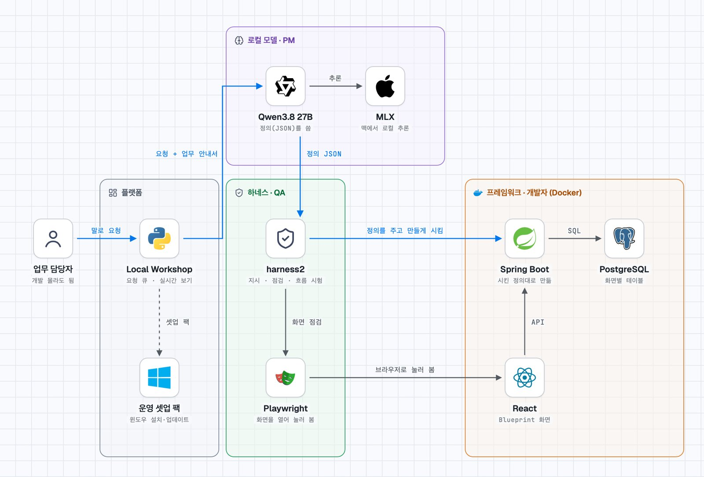
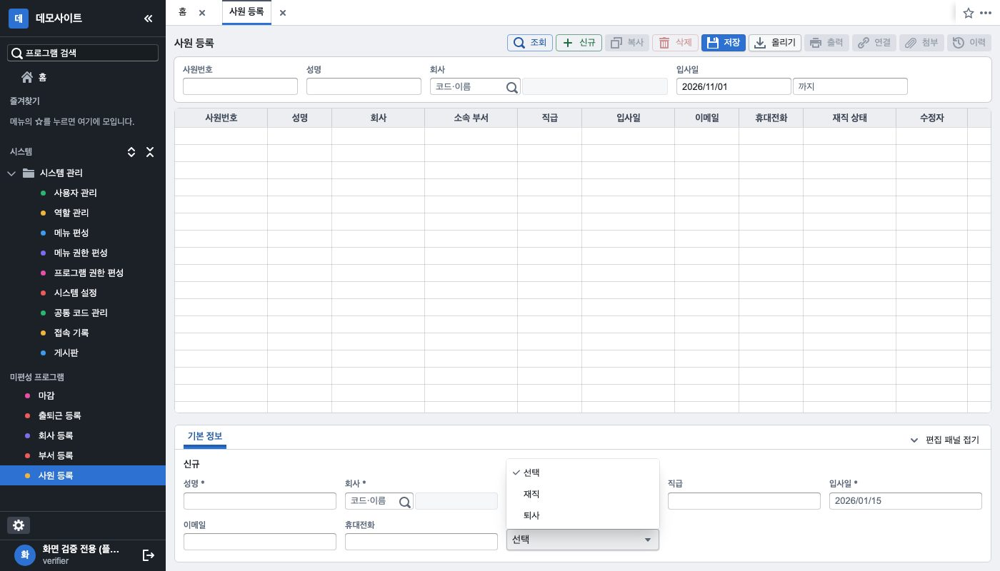
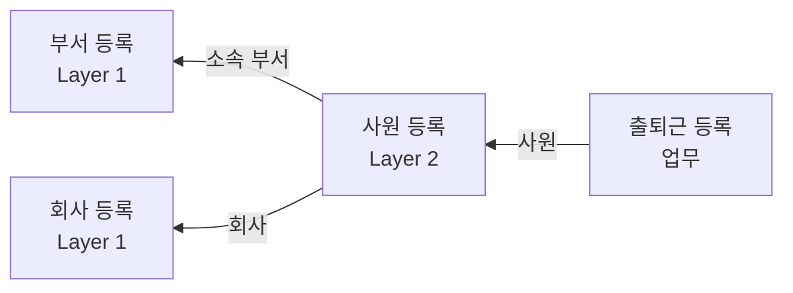
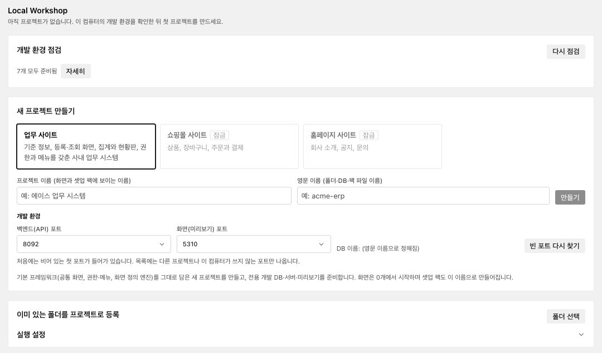

# Local Workshop — 말로 만드는 업무 앱

> 개발자가 아닌 사람이 평소 말투로 **"동호회 가입 신청 화면 만들어줘. 이미 들어 있는 동호회에 또 신청하면 안 돼."** 라고 요청하면,
> 이 컴퓨터에서 도는 **로컬 모델**이 화면을 설계하고, **하네스**가 실제로 해 보고 점검한 뒤, 통과한 것만 업무 앱에 반영하는 플랫폼입니다.

외부 API 없이 맥 한 대(Apple Silicon, 32GB)에서 돌아갑니다. 모델은 Qwen3.8-27B 4bit(MLX)입니다.
이 저장소는 "약한 로컬 모델을 어떻게 쓸 만하게 만드는가"라는 **하네스 엔지니어링** 실험의 결과물이기도 합니다.



---

## 목차

1. [핵심 아이디어](#핵심-아이디어)
2. [세 역할: 모델 · 하네스 · 프레임워크](#세-역할-모델--하네스--프레임워크)
3. [아키텍처](#아키텍처)
4. [요청 한 건이 지나가는 길](#요청-한-건이-지나가는-길)
5. [화면 정의와 프레임워크 부품](#화면-정의와-프레임워크-부품)
6. [바탕이 된 이론과 개념](#바탕이-된-이론과-개념)
7. [플랫폼에서 할 수 있는 일](#플랫폼에서-할-수-있는-일) — 형상 관리 포함
8. [필요한 것](#필요한-것)
9. [설치와 시작](#설치와-시작)
10. [명령줄로 다루기 (ctl.py)](#명령줄로-다루기-ctlpy)
11. [운영 배포: 윈도우 셋업 팩](#운영-배포-윈도우-셋업-팩)
12. [저장소 구성](#저장소-구성)
13. [점검과 테스트](#점검과-테스트)
14. [지금의 한계](#지금의-한계)
15. [참고](#참고)

---

## 핵심 아이디어

**약한 모델에게는 많은 자율성과 세밀한 수행을 기대하지 않습니다.**

처음에는 로컬 모델에게 화면 코드를 직접 쓰게 했습니다. 화면 하나를 고치는 데 수십 번을 오갔고, 한 곳을 고치면 다른 곳이 깨졌습니다.
결과가 좋아진 건 모델에게 맡기는 몫을 줄였을 때였습니다.

| | 모델에게 맡기지 않는 것 | 대신 하는 쪽 |
|---|---|---|
| 자율성 | 코드를 자유롭게 쓰기 | 정해진 모양의 **정의(JSON) 하나**만 쓴다 |
| 세밀한 수행 | 저장, 이력, 권한, 한도, 화면 배치 | 검증된 **프레임워크 부품**이 한다 |
| 자기 판정 | "다 됐습니다"라는 모델의 말 | **하네스**가 직접 해 보고 판정한다 |

모델은 **업무의 뜻을 판단하는 일**만 합니다. 어떤 항목이 필요한지, 이 화면이 기준 정보인지 업무인지, 어느 화면을 가리키는지 같은 것입니다.

---

## 세 역할: 모델 · 하네스 · 프레임워크

| 역할 | 누가 | 하는 일 |
|---|---|---|
| **기획 · PM** | 로컬 모델 (Qwen3.8-27B 4bit, MLX) | 요청을 읽고 화면 **정의(JSON)** 를 씁니다. 코드는 쓰지 않습니다. |
| **품질 · QA** | 하네스 (`harness2/`) | 모델이 쓴 정의를 프레임워크에 주고 **만들게 시킨 뒤**, 시험용 사본에서 저장·조회·규칙·한도·연계·업무 흐름을 실제로 해 보고, 브라우저로 화면을 열어 눌러 봐서 통과한 것만 반영합니다. |
| **개발자** | 프레임워크 (`platform/base/`) | **하네스가 시키는 대로** 정의를 받아 테이블·API·권한·이력·화면을 만듭니다. 조회 그리드, 입력 화면, 연계, 수량 한도 같은 기능 부품을 가졌고, 업무는 모릅니다. 업무 이름은 정의에서만 나옵니다. |
| 결정 | 사람 | 무엇을 만들지 말하고, 결과를 보고 원복할지 정합니다. |

**플랫폼**(`platform/`)은 이 셋을 묶어, 개발자가 아니어도 화면에서 프로젝트 만들기, 요청, 변경 이력과 원복, 운영 셋업 팩 만들기를 하게 해 줍니다.

---

## 아키텍처


- **플랫폼**은 사람이 쓰는 유일한 창구입니다. 요청, 진행 상황, 결과, 형상 관리, 배포를 모두 여기서 합니다.
- **하네스**는 플랫폼이 요청마다 부르는 도구입니다. 모델에게 정의를 쓰게 하고, 그 정의를 프레임워크에 주어 만들게 시키고, 만든 것을 점검합니다.
- **프레임워크**는 하네스가 시키는 대로 만드는 개발자입니다. 프로젝트마다 하나씩 도는 서버(Spring Boot + PostgreSQL, Docker)지만 원본은 플랫폼에 하나(`platform/base`)입니다.
- **프로젝트**는 각자 깃 기록·개발 DB·포트를 가지고, 운영에는 셋업 팩으로 나갑니다.

---

## 요청 한 건이 지나가는 길

| # | 누가 | 단계 | 하는 일 |
|---|---|---|---|
| 1 | 사용자 | 요청 | 업무 담당자의 말을 그대로 받습니다. |
| 2 | 모델 | 계획 | 화면이 여럿 필요하면 한 화면씩 단계로 나눕니다. |
| 3 | 하네스 | 계획 점검 | 단계 문장이 요청에 없는 조건·화면·낱말을 덧붙였는지 보고, 그렇다면 다시 나누게 합니다. |
| 4 | 모델 | 정의 쓰기 | 고정된 부품 설명 + 요청 + 업무 안내서를 읽고 정의(JSON)를 씁니다. |
| 5 | 프레임워크 | 정의 판정 | 모양과 규칙에 어긋나면 이유와 함께 모델에게 돌려보냅니다. 다른 화면이 쓰는 항목을 지우려 하면 막습니다. |
| 6 | 하네스 | 시험 사본 점검 | 메뉴에 보이지 않는 사본에서 저장·조회·규칙·한도·연계를 해 보고, 브라우저(Playwright)로 화면을 눌러 봅니다. |
| 7 | 하네스 | 게시 후 규칙 점검 | 다른 화면을 가리키는 규칙과 자동 처리를 게시본으로 확인합니다. |
| 8 | 하네스 | 업무 흐름 시험 | 등록된 업무 흐름(예: 신청 → 승인 → 발급)을 처음부터 끝까지 돌려 봅니다. |
| 9 | 하네스 | 요청 전체 대조 | 모든 단계가 통과해도 원래 문장과 다시 맞춰, 빠진 것이 있으면 반영하지 않습니다. |
| 10 | 플랫폼 | 적용 | 프로젝트의 깃 기록과 실행 기록을 남깁니다. 마지막 변경은 원복할 수 있습니다. |

**떨어지면** 그 요청이 만든 것을 모두 원복합니다(반쯤 된 결과는 남지 않습니다).
업무 흐름 시험이나 요청 대조에서 떨어졌거나 단계 중간에 멈췄으면, 그 이유를 모델에게 전하고 한 번 더 만듭니다. 통과하면 **"재시도 후 완료"** 로 기록됩니다.

### 속도: 고정 부분은 시스템 메시지로

모델에게 주는 입력 중 부품 설명(약 1만 2천 토큰)은 매번 같습니다. 이 모델(`qwen3_5` 구조, 선형 어텐션 층 포함)은 기억해 둔 입력을 중간에서 잘라 다시 쓰지 못하고,
MLX 서버는 메시지 경계에서 캐시를 남깁니다. 그래서 고정 부분을 **시스템 메시지**로 분리했습니다.

| | 정의 한 번 쓰는 데 걸린 시간 |
|---|---|
| 분리 전 (매번 처음부터 읽음) | 약 240~330초 |
| 분리 후 첫 요청 | 약 290초 (한 번은 다 읽음) |
| 분리 후 그다음 | **37~66초** |
| 요청과 맞는지 확인 (같은 대화 안에서) | 약 8초 |

---

## 화면 정의와 프레임워크 부품

정의 하나가 화면 하나입니다.

```json
{ "title": "출퇴근 등록", "kind": "work",
  "fields": [
    { "name": "empId",    "label": "사원",     "type": "ref",
      "ref": { "entity": "employee" }, "required": true },
    { "name": "workDate", "label": "근무일",   "type": "date", "required": true },
    { "name": "clockIn",  "label": "출근 시각", "type": "time", "required": true }
  ] }
```

정의를 저장하면 프레임워크가 그 자리에서 다음을 꾸립니다. 빌드나 배포는 없습니다.

- 화면마다 **실제 DB 테이블**(`r_<key>`)과 **이력 테이블**(`h_<key>`)
- 조회·저장·삭제 API, 프로그램 권한, 메뉴
- Blueprint 기반 화면: 조회 조건, 공통 버튼, 그리드, 입력 영역, 엑셀 내보내기·올리기, 출력



### 부품 목록 (정의에 적는 키)

| 키 | 하는 일 |
|---|---|
| `fields` | 화면의 항목 (글자, 숫자, 날짜, 시각, 코드, 다른 화면 가리키기, 자동 번호, 계산 …) |
| `kind` | `master`(기준 정보) / `work`(업무). 모양으로 추측하지 않고 모델이 뜻으로 판단해 적습니다 |
| `lines`, `moreLines` | 한 건 아래 딸린 줄 표 |
| `status` | 진행 상태와 상태를 바꾸는 버튼, 끝난 상태 |
| `checks` | 한 건 안의 비교 (종료일 ≥ 시작일 …) |
| `rules` | 다른 자료와 얽힌 금지 규칙 |
| `limits` | 다른 자료를 넘지 못하는 한도 (출하 ≤ 수주, 배정 인원 ≤ 정원) |
| `effects` | 등록·상태 변경 때 따라 일어나는 일 |
| `take` | **연계 화면**: 앞 단계에서 미처리 잔량을 조회해 선택하고 저장하면 다음 단계가 만들어짐 |
| `from`, `follows` | 앞 자료에서 이어 만드는 자료 |
| `over` | 업무 화면: 이미 있는 자료를 정한 상태·동작만으로 연다 (승인, 처리 대기) |
| `noOverlap` | 같은 대상의 기간이 겹치지 않게 (예약, 대여) |
| `effective` | 적용 기간이 있는 기준 정보 |
| `ledger`, `ledgerView` | 수량 원장 (들임·뺌·옮김·셈)과 그 조회 |
| `summary`, `dashboard` | 집계 화면, 현황판 |
| `calendar`, `tree` | 달력 화면, 트리 화면 |
| `print` | 종이 양식 출력 |
| `period` | 목록을 처음 열 때의 기간 |

부품 설명은 `platform/base/backend/.../framework/app/AppDefinitions.java` 에 있고, 모델은 이 설명만 읽습니다(부품의 소스는 보지 않습니다).

### 기본으로 들어 있는 시스템 화면

로그인, 사용자 관리, 역할 관리, 메뉴 편성, 메뉴 권한 편성, 프로그램 권한 편성, 시스템 설정, 공통 코드 관리, 접속 기록, 게시판, 마감.

### 지키는 원칙

- **업무는 지시에서 시작합니다.** 수주·신청 같은 지시 화면에서 출발하고, 후속 단계는 그리드에서 미처리 잔량을 선택해 등록합니다. 편집 패널은 언제나 한 건만 다룹니다.
- **기준 정보는 층(Layer)으로 누적됩니다.** 품목·창고(Layer 1) → BOM·공정 순서(Layer 2) → 그 조합(Layer 3). 업무는 이것을 선택해 씁니다.
- **의존 관계는 자료 구조입니다.** 어느 화면이 무엇을 가리키는지 프레임워크가 한곳(`ProcessGraph`)에서 관리하고, 업무 흐름도·삭제 제한·항목 변경 제한이 모두 같은 데이터를 읽습니다.
- **요청받지 않은 부품은 만들지 않습니다.** 실패는 프롬프트 규칙을 누적해서 덮지 않고, 프레임워크 부품과 점검으로 고칩니다.
- **앱에는 만드는 쪽의 말이 나오지 않습니다.** 업무 안내서·정의·점검 결과는 플랫폼에만 있습니다.

---

## 바탕이 된 이론과 개념

새로운 이론을 만든 것은 아닙니다. 이미 검증된 생각들을 약한 모델에 맞게 엮었습니다.

| 이론 · 개념 | 이 플랫폼에서는 |
|---|---|
| **그래프 이론** | 화면은 **노드**, 다른 화면을 가리키는 항목은 **방향 간선**입니다. Layer는 가리키는 기준 정보 중 가장 깊은 것 + 1(가장 긴 경로의 깊이), 삭제 제한은 "들어오는 간선이 있는가", 업무 흐름은 그래프 위의 **경로**, BOM·조직도의 순환 금지는 **사이클 검사**입니다. |
| **메타데이터 주도 개발 · 선언형** | 모델은 "무엇이 필요한가"만 **선언**하고, "어떻게"는 프레임워크가 합니다. 정의(메타데이터)가 테이블·API·화면·권한의 **단일 원천**이고, 흐름도·안내서·점검도 모두 정의에서 뽑습니다. |
| **관계형 모델 · ER 모델** | 화면마다 실제 테이블, 가리키는 항목은 **외래 키**, 이력은 화면별 이력 테이블(**감사 추적**). 기준 정보와 업무 기록을 나누는 것은 ERP의 **마스터/트랜잭션** 구분입니다. |
| **ERP 생산·물류 관리** | 업무는 **지시 → 실적**, 후속 단계는 **미처리 잔량**(open quantity)을 연계해 처리, 한도는 "출하 ≤ 수주", 기준 정보는 BOM처럼 **다단계로 전개**됩니다. |
| **트랜잭션의 원자성** | 요청 하나는 **전부 아니면 전무**입니다. 중간에 떨어지면 만든 것을 모두 원복하고, 운영 셋업 팩도 통째로 반영되거나 원래대로 돌아갑니다. |
| **실수 방지 (포카요케)** | 도요타 생산방식의 **실수가 일어날 수 없게 만드는 장치**. 모델이 틀려도 프레임워크가 구조적으로 막습니다: 쓰이는 항목 삭제 금지, 한도 초과 거절, 정해진 모양 밖의 정의 거절. |
| **다층 방어 (스위스 치즈 모델)** | 점검 하나는 구멍이 있어도 여러 겹이면 통과하기 어렵습니다. **계획 점검 → 정의 판정 → 시험 사본 → 흐름 시험 → 요청 대조**를 겹쳐 둔 이유입니다. |
| **명세 기반 테스트 · 독립 오라클** | 점검은 모델이 쓰지 않고 **정의에서 뽑습니다**. 집계 화면은 하네스가 숫자를 **따로 계산해** 맞춰 보고, 업무 흐름은 처음부터 끝까지 돌리는 **E2E 시험**입니다. 시험은 운영과 떨어진 **시험 사본**에서 합니다. |
| **관심사 분리 · 만드는 쪽과 검사하는 쪽 분리** | 설계(모델), 구현(프레임워크), 검사(하네스), 결정(사람)을 나눴습니다. 자기 결과를 자기가 판정하지 않게 하는 **4-eyes 원칙**과 같습니다. |
| **홀드아웃 평가 · 블라인드 테스트** | 머신러닝에서 학습에 쓰지 않은 데이터로 평가하듯, 요청 문장은 **저장소를 보지 않은 다른 에이전트**가 쓰고 이미 시험한 업무는 다음 회차에서 뺐습니다. 예시를 바꿀 때는 **A/B 비교**로 쟀습니다. |
| **KV 캐시 · 접두 재사용** | 트랜스포머는 읽은 입력을 KV 캐시로 기억합니다. 매번 같은 부품 설명을 **앞부분(시스템 메시지)**에 고정해, 두 번째 요청부터 다시 읽지 않게 했습니다. |
| **제한된 자율성** | 약한 모델은 **선택지가 적을수록** 덜 틀립니다. 자유 코드 대신 정해진 모양의 출력(구조화 출력)만 허용하고, 판단이 필요한 곳(업무의 뜻)에만 모델을 씁니다. |



화면 의존 그래프의 예입니다. 화살표는 "가리킨다(의존한다)"는 뜻이고, 업무 흐름도·Layer·삭제 제한이 모두 이 그래프를 읽습니다(`ProcessGraph.dependsOn`).

---

## 플랫폼에서 할 수 있는 일

### 업무
| 메뉴 | 하는 일 |
|---|---|
| **만들기** | 말로 요청합니다. 여러 요청은 대기열에 줄을 서고, 도는 요청은 중지할 수 있습니다. 결과에는 통과한 점검, 바뀐 화면, 생기거나 바뀐 테이블·API가 나옵니다. 마지막 요청은 원복할 수 있습니다. |
| **실시간 보기** | 모델이 입력을 읽는 진행, 쓰고 있는 정의, 단계와 점검이 실시간으로 보입니다. |
| **앱 보기** | 만든 업무 앱을 플랫폼 안에서 바로 엽니다. |
| **업무 안내서** | 정의에서 저절로 만든 업무 설명 (기준 정보 Layer, 지시·실적, 연계·처리 화면). 프로젝트에 대해 묻는 채팅이 붙어 있습니다. |
| **업무 흐름도** | 화면 사이의 의존 관계(어느 항목이 어느 화면을 가리키는지)와 업무 흐름을 그림으로 보여 줍니다. |
| **변경 이력** | 형상 관리 (아래). |

### 형상 관리 (변경 이력)

개발을 모르는 사람도 쓸 수 있게 깃을 쉬운 말로 감쌌습니다. 프로젝트마다 플랫폼과 별개의 깃 저장소가 있습니다.

| 하는 일 | 화면에서 | 깃으로는 |
|---|---|---|
| 요청이 적용될 때마다 자동 기록 (작성자: 로컬 모델) | 변경 이력 목록 | commit |
| 사람이 손으로 고친 것을 기록 | 「무엇을 바꿨나요?」 → 기록하기 | commit |
| 기록마다 무엇이 바뀌었는지, 모델과 무엇을 주고받았는지 보기 | AI 작업 기록 보기 | log / diff |
| 특정 변경만 취소 | 이 변경 취소하기 | revert |
| 작업 공간 만들기·바꾸기 | 새 작업 공간 이름 → 만들고 전환 | branch / switch |
| 원격 저장소 연결 | 원격 저장소 주소 → 연결 | remote |
| 원격에 올리기 (올리지 않은 기록 수 표시) | 원격에 올리기 | push |
| 개발 사이트를 깃 상태로 맞추기 | (명령줄 `sync`) | checkout + 반영 |

### 설정
| 메뉴 | 하는 일 |
|---|---|
| **프로젝트** | 새 프로젝트 만들기(사이트 종류 선택, 지금은 업무 사이트), 이름 바꾸기, 지우기, 기존 폴더를 프로젝트로 등록. 백엔드·화면 포트(빈 포트 찾기), 프로젝트 서버, **개발 DB 백업과 백업에서 되돌리기**, **운영 셋업 팩** 만들기·내려받기(현재 판), **프레임워크 판**과 반영 상태. |
| **개발 환경** | 도커·개발 DB·Node·점검용 브라우저·모델 서버를 점검하고, 없는 것은 하나씩 또는 한 번에 셋업합니다. 도구 경로를 직접 지정할 수도 있습니다. |
| **AI 모델** | 모델 설정(API 주소, 모델 ID, 출력 토큰, 응답 대기, temperature) 추가와 연결 확인, 프로젝트 기본 모델 지정. |

### 개발자 도구
| 메뉴 | 하는 일 |
|---|---|
| **화면 정의·자료·서버** | 화면마다 정의(판별 비교, 이력), 저장된 자료, 프로젝트 서버 로그. |
| **실행 기록** | 요청마다 모델 호출, 점검 결과, 소요 시간, 실패한 첫 시도의 이유("재시도 후 완료"). |
| **통계** | 요청·점검·모델 사용 통계. |
| **프로젝트 소스** | 프로젝트 폴더의 파일을 읽기 전용으로 봅니다. |
| **채팅** | 로컬 모델과 대화하거나 프로젝트에 대해 묻습니다(파일을 고치지 않습니다). |

그 밖에: **앱 창**(`Local Workshop.command`, Electron)으로 열면 플랫폼 서버·도커·모델 서버·프로젝트 서버가 꺼져 있을 때 켭니다. **플랫폼 팩**으로 플랫폼 자체를 다른 맥에 옮깁니다.

<table>
<tr><td></td><td></td></tr>
<tr><td align="center">처음 화면 — 개발 환경 점검과 새 프로젝트</td><td align="center">실시간 보기</td></tr>
<tr><td></td><td></td></tr>
<tr><td align="center">업무 흐름도 (의존 관계)</td><td align="center">요청 기록 — 재시도 후 완료</td></tr>
</table>

---

## 필요한 것

| 항목 | 내용 |
|---|---|
| 컴퓨터 | Apple Silicon 맥, 메모리 **32GB 이상** (모델 가중치만 약 15.5GB) |
| 도커 | 개발 DB(PostgreSQL), 업무 앱 서버의 빌드와 실행 |
| Node.js | 플랫폼 화면 빌드, 업무 앱 화면 |
| Python | 3.9 이상 (플랫폼 서버, 하네스) |
| 모델 실행 | `mlx_lm` 이 든 가상환경 `~/.local/share/mlx-server/venv`, 모델 `mlx-community/Qwen3.8-27B-4bit` |
| 화면 점검 | Playwright + Chromium |

도커, 개발 DB, Node, 점검용 브라우저는 플랫폼의 **설정 › 개발 환경**에서 점검하고 버튼으로 셋업할 수 있습니다.

---

## 설치와 시작

```sh
git clone https://github.com/igkrap/harness101-local.git
cd harness101-local

# 1) 로컬 모델 서버 (8099) - 꺼지면 같은 설정으로 다시 띄웁니다
bash platform/scripts/qwen-serve-forever.sh &

# 2) 플랫폼 화면 빌드
cd platform/web && npm ci && npm run build && cd ..

# 3) 플랫폼 서버
python3 server.py            # http://127.0.0.1:5293
```

또는 저장소 맨 위의 **`Local Workshop.command`** 를 두 번 누르면 플랫폼을 앱 창으로 엽니다(꺼져 있는 플랫폼 서버·도커·모델 서버·프로젝트 서버를 켭니다).

처음 열면 프로젝트가 없습니다. **개발 환경 점검 → 새 프로젝트 만들기 → 만들기에서 요청** 순서로 시작합니다.
프로젝트는 `projects/<이름>/` 에 생기고, 각자 깃 기록·개발 DB·서버 포트를 가집니다(이 저장소에는 들어가지 않습니다).

> **모델 서버 메모리 주의** — `mlx_lm` 서버의 `--prompt-cache-bytes` 는 순차 처리 경로에서 지켜지지 않아 캐시가 계속 커지다 Metal 메모리 부족으로 죽을 수 있습니다.
> 이 환경에서는 `mlx_lm/server.py` 의 `LRUPromptCache` 에 `max_bytes` 를 넘기도록 고쳐 쓰고 있습니다. `mlx_lm` 을 올리면 다시 적용해야 합니다.

---

## 명령줄로 다루기 (ctl.py)

플랫폼 화면에서 하는 일은 `platform/ctl.py` 로도 할 수 있습니다. 결과는 JSON으로 나옵니다.

```sh
cd platform
python3 ctl.py projects                         # 프로젝트 목록
python3 ctl.py create my-erp "우리 회사 업무"     # 새 프로젝트
python3 ctl.py -p my-erp ask "사원 등록 화면 만들어줘"   # 요청 (하네스를 거쳐 적용)
python3 ctl.py -p my-erp screens                # 화면 목록
python3 ctl.py -p my-erp undo-request <요청 번호> # 요청 하나가 적용한 것 원복
python3 ctl.py -p my-erp pack                   # 운영 셋업 팩 만들기
python3 ctl.py -p my-erp log                    # 변경 이력
python3 ctl.py -p my-erp commit -m "메뉴 이름 정리"   # 손으로 고친 것 기록
python3 ctl.py -p my-erp undo --sha <기록>      # 특정 변경 취소
python3 ctl.py -p my-erp branch try-1 --create  # 작업 공간 만들고 전환
python3 ctl.py -p my-erp remote <원격 주소>      # 원격 저장소 연결
python3 ctl.py -p my-erp push                   # 원격에 올리기
python3 ctl.py -p my-erp sync                   # 개발 사이트를 깃 상태로 맞추기
python3 ctl.py framework                        # 프레임워크 판과 프로젝트별 상태
python3 ctl.py framework-update                 # 프레임워크를 모든 프로젝트에 반영
```

전체 명령: `projects, ports, create, rename, remove, status, screens, screen, records, server-log, apply, ask, commit, undo, branch, sync, remote, push, log, pack, undo-request, framework, framework-update`

### 프레임워크는 플랫폼에 하나

프레임워크 원본은 `platform/base/` 하나이고 모든 프로젝트가 함께 씁니다. 바뀌면 플랫폼이 모든 프로젝트에 같이 반영하고,
백엔드는 DB 사본으로 먼저 빌드해 보고(실패하면 원래대로 둠), 화면은 타입 검사하고, 각 프로젝트의 업무 흐름을 끝까지 돌려 봅니다.
프로젝트가 가진 것은 그 프로젝트에서 만든 것(`release/` 의 정의·메뉴·코드·흐름)뿐입니다.

---

## 운영 배포: 윈도우 셋업 팩

만든 업무 앱은 **윈도우 서버/PC용 셋업 팩**으로 나갑니다. 인터넷과 도커가 없는 곳을 가정합니다.

- `-install.zip` — 처음 설치: 함께 든 Java 런타임과 PostgreSQL, 윈도우 서비스 등록, DB 생성
- `-update.zip` — 업데이트: 앱만 바꾸고, 먼저 백업하며, 실패하면 저절로 원래대로 돌아갑니다

팩은 운영 쪽의 자료·사용자·권한을 건드리지 않습니다. 서버가 시작할 때 팩의 정의를 한꺼번에(전부 아니면 전무) 반영합니다.
플랫폼에는 현재 판만 남습니다. 만드는 곳은 `platform/release.py`, `platform/windows_pack.py` 입니다.

> 윈도우용 PowerShell 스크립트는 맥에서 문법 검사만 했고, 실제 윈도우에서 돌려 보지는 않았습니다.

플랫폼 자체를 다른 맥에 옮기는 **플랫폼 팩**(`platform/platform_pack.py`)도 있습니다. 프로젝트 없이 플랫폼·프레임워크·하네스만 담고, 모델 파일은 따로 옮기거나 설치 때 받습니다.

---

## 저장소 구성

```
.
├── Local Workshop.command   두 번 눌러 플랫폼을 앱 창으로 엶
├── platform/                플랫폼
│   ├── server.py            플랫폼 서버 (5293)
│   ├── ctl.py               명령줄
│   ├── web/                 플랫폼 화면 (React)
│   ├── base/                프레임워크 원본 — 모든 프로젝트가 함께 씀
│   │   ├── backend/         Spring Boot (정의 → 테이블·API·권한·이력)
│   │   └── frontend/        React + Blueprint (화면 부품)
│   ├── framework_update.py  프레임워크를 모든 프로젝트에 반영
│   ├── release.py           운영 셋업 팩
│   ├── windows_pack.py      윈도우 설치용·업데이트용 팩
│   ├── platform_pack.py     플랫폼 자체를 옮기는 팩
│   ├── first_setup.py       개발 환경 첫 셋업
│   ├── desktop/             앱 창 (Electron)
│   ├── scripts/             모델 서버 실행 스크립트
│   └── tests/               점검 (control_check, flow_check …)
├── harness2/                하네스
│   ├── run.py               요청 한 건의 흐름 (계획 → 정의 → 점검 → 게시 → 흐름 시험)
│   ├── define.py            모델에게 정의를 쓰게 함, 계획 점검, 요청 대조
│   ├── checks.py            정의에서 뽑은 점검 (저장·조회·규칙·한도·연계·화면)
│   ├── flows.py             업무 흐름을 처음부터 끝까지 시험
│   ├── llm.py, live.py      모델 호출(스트리밍·중지), 실시간 보기 상태
│   └── framework.py         프레임워크 API 호출
├── erp-harness/             브라우저 화면 점검 도구 (react_layout_inspector, verification_dom)
│                            ※ 예전 '모델이 코드를 쓰던' 경로의 파일이 일부 남아 있습니다
└── projects/                플랫폼에서 만든 프로젝트 (저장소 밖, 각자 깃 기록)
```

---

## 점검과 테스트

```sh
cd platform
python3 tests/control_check.py     # 프로젝트 만들기부터 요청·원복·삭제까지 제어 경로 전체 (점검용 프로젝트를 만들고 지움)
python3 tests/flow_check.py        # 업무 흐름 판정이 화면 하나로는 못 보는 것을 잡는지
```

하네스가 요청마다 남기는 기록(모델과 주고받은 것, 점검 결과, 적용 전후 정의)은 프로젝트별로 `platform/state/projects/<id>/runs/` 에 남고, 플랫폼의 **실행 기록**에서 볼 수 있습니다.

### 측정 방식

처음 보는 업무로 범용성을 재기 위해, 요청 문장은 **다른 에이전트(Codex)** 가 "개발을 모르는 회사 직원" 역할로 씁니다.
그 에이전트는 이 저장소의 파일을 열지 않고 개발 용어를 쓰지 않으며, 이미 시험한 업무는 다음 회차에서 뺍니다(여섯 차례).
기준 정보 화면은 거의 항상 첫 시도에 통과했고, 여러 단계를 잇는 업무 흐름이 가장 어려웠습니다.

---

## 지금의 한계

- **흐름 설계**: 여러 단계를 잇는 업무(신청 → 승인 → 발급)는 아직 첫 시도에 자주 떨어집니다.
- **모델의 낱말 실수**: 요청에 없던 낱말이 정의에 섞이는 일이 가끔 있습니다(계획 점검과 요청 대조로 걸러 냄).
- **환경**: Apple Silicon 맥 전용입니다(MLX). 다른 맥에 플랫폼 팩을 처음 설치하는 경험은 아직 다듬는 중입니다.
- **윈도우 셋업 팩**: 실제 윈도우에서는 아직 돌려 보지 않았습니다.

---

## 참고

- 출발점: [Harness Engineering 101](https://github.com/IsuruMaduranga/harness-engineering-101) (MIT) — 이 교재의 토이 하네스를 로컬 모델로 돌려 보는 데서 시작했습니다.
- 모델: [Qwen3.8-27B 4bit (mlx-community)](https://huggingface.co/mlx-community/Qwen3.8-27B-4bit), [MLX LM](https://github.com/ml-explore/mlx-lm)
- 화면: [Blueprint](https://blueprintjs.com/), 점검: [Playwright](https://playwright.dev/)
