# 로컬 MoE 모델로 「Harness Engineering 101」 따라 해 보기 — 체험 후기

> 책: [Harness Engineering 101](https://isuruwijesiri.com/harness-engineering-101/) (Isuru Wijesiri, v1.1, 2026-10) · 코드: [GitHub](https://github.com/IsuruMaduranga/harness-engineering-101) (MIT)
> 환경: Mac mini M4 · 32GB · **gemma-4-26B-A4B** (MoE, 4bit, `mlx_lm.server`) · 컨텍스트 **32k 토큰 제한** · 명령 실행은 Docker(네트워크 차단)
> 실습일: 2026-10-31

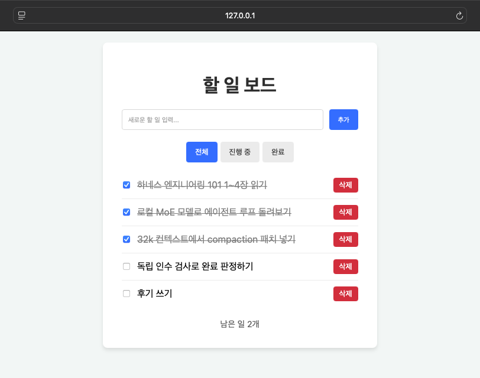

**한 줄 요약**: 책의 300줄짜리 토이 하네스를 로컬 MoE 모델에 연결하고, 빈 폴더에서 웹앱을 만들게 했습니다. 위 화면이 그 결과입니다. 최종 결과는 독립 인수 검사 9/9이지만 처음부터 그렇지는 않았습니다. 모델은 세 번 "완료"를 선언했고, 그때마다 검사가 버그를 찾아냈습니다. 그 사이에 하네스 쪽 버그 세 개를 직접 고쳐야 했습니다.

---

## 1. 이 책이 말하는 것

책의 주장은 한 문단으로 요약됩니다.

> An LLM API is stateless. Every turn, you send the entire conversation as a JSON array and get text back. A **harness** is the program that builds, maintains, and protects that array using a simple loop. Everything the field calls "agents" is a set of patches to that one loop, and each patch exists because something concrete broke.

모든 장이 **고장 → 최소 패치 → 그 패치의 비용** 순서로 쓰여 있고, 장이 진행될수록 토이 하네스가 v1(채팅) → v2(Tool) → v3(에이전트 루프) → v4(서브에이전트) → 완성본(`harness.py`, 약 300줄)으로 자랍니다. 이번 체험에서는 이 다섯 단계를 **클라우드 API 대신 내 Mac의 MoE 모델**로 그대로 돌려 봤습니다.

## 2. 준비: 두뇌만 바꾸기

책의 코드는 Anthropic Messages API 전용입니다. 하네스 본체는 그대로 두고 **통신부(wire)만** 바꿨습니다.

| 파일 | 역할 |
|---|---|
| `harness/local_llm.py` (135줄) | 책의 요청 body(Anthropic 형식)를 그대로 받아 OpenAI 호환 형식으로 바꿔 로컬 MLX 서버에 보내고, 응답을 다시 Anthropic 형식(`content` 블록, `stop_reason`, `usage`)으로 돌려줌. 32k 예산 검사, 토큰·캐시·속도 기록 |
| `harness/sandbox.py` (42줄) | 파일 Tool은 작업 폴더 안 상대 경로만 허용. `run_command`는 **네트워크 없는 Docker 컨테이너**에서 실행 |

책 코드에서 바뀐 줄은 다섯 파일을 합쳐 +82/−76줄입니다. `harness.py` 변경의 대부분은 아래 4장에서 설명할 패치 3개입니다.

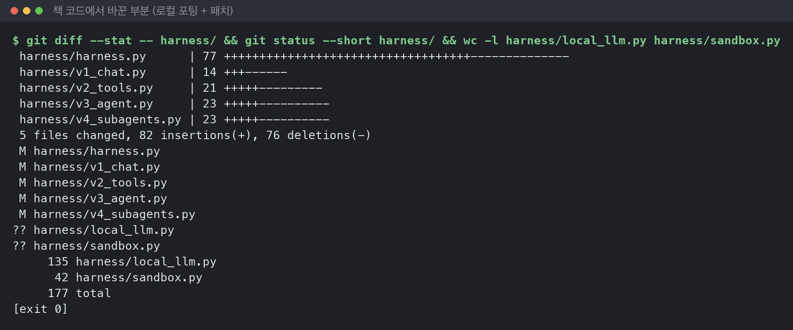

> **느낀 점.** 책 부록 A의 제목 "One Harness, Many Brains"가 말 그대로였습니다. 배열을 만드는 쪽(하네스)과 배열을 읽는 쪽(모델)이 분리돼 있으니, 두뇌를 클라우드 프런티어 모델에서 로컬 MoE로 바꿔도 몸은 거의 그대로였습니다.

> **격리는 책보다 한 단계 더 했습니다.** 책의 토이는 `run_command`를 내 컴퓨터 셸에서 그대로 실행합니다(책도 스스로 "deliberate toy"라고 밝힙니다). 로컬 모델이 내 Mac의 셸을 직접 쥐는 건 받아들이기 어려워서, 13장(Reflexes)과 부록 B(Isolation)의 논리대로 손을 컨테이너 안에만 두었습니다.

## 3. 단계별로 따라 하기

### v1 — 배열이 곧 대화 (1장)

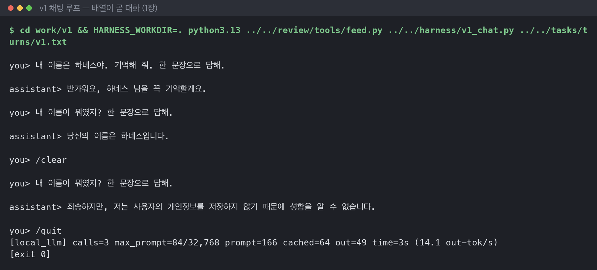

모델은 "하네스"라는 이름을 기억하는 것처럼 보이지만, 실제로는 매번 대화 전체를 다시 보내고 있을 뿐입니다. `/clear`는 코드상 `messages = []` 한 줄이고, 그 순간 모델은 이름을 모릅니다. 마지막 줄의 `cached=64`는 로컬 MLX 서버도 **앞부분이 같은 배열을 캐시한다**는 증거입니다(5장).

### v2 — Tool은 JSON을 함수 호출로 바꾸는 것 (3장)

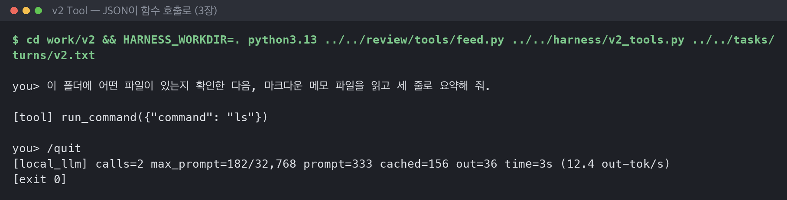

"파일 목록을 보고, 메모를 읽고, 요약해 줘"라고 했는데 **답이 없습니다.** 모델은 `ls`를 요청했고 v2는 그것을 실행했습니다. 그다음 모델이 메모를 읽으려고 두 번째 Tool을 요청하자, v2는 그 요청을 **조용히 버립니다**(책 코드의 주석: *"If reply2 asks for ANOTHER tool, v2 drops it. Chapter 4."*). 책이 4장의 동기로 든 실패를 로컬 모델에서 그대로 재현했습니다.

### v3 — 에이전트는 while 루프 (4장)

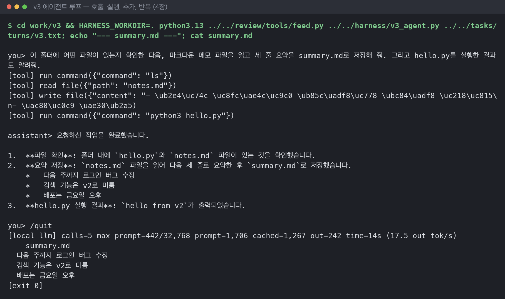

같은 요청을 v3에 주면 `ls` → `read_file` → `write_file` → `run_command`를 스스로 이어 가고 요약 파일까지 만듭니다. 바뀐 것은 "Tool을 요청하는 동안 계속 돈다"는 루프 하나입니다. 책의 표현 그대로 **"An agent is a while loop around a chat completion."** 이 장에서 가장 크게 와닿았습니다.

### v4 — 서브에이전트는 새 배열로 도는 같은 루프 (7장)

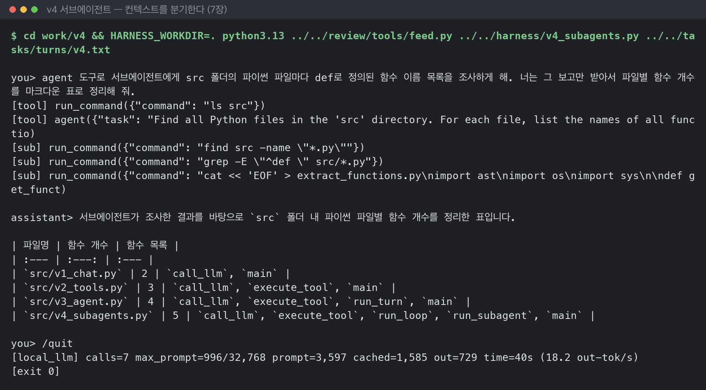

메인 에이전트는 `agent` Tool로 조사를 위임하고, 서브에이전트(`[sub]`)는 **빈 배열**에서 시작해 `find`, `grep`, 직접 작성한 파싱 스크립트로 조사한 뒤 보고서만 돌려줍니다. 표는 실제 파일과 대조해 보니 정확했습니다. 다만 서브에이전트가 만든 `extract_functions.py`가 작업 폴더에 **남아 있었습니다.** 컨텍스트는 분기되지만 파일 시스템은 분기되지 않는다는 점, 즉 부록 B(worktree 격리)가 왜 필요한지를 바로 보여 준 장면입니다.

## 4. 완성본으로 웹앱 만들기

### 과제와 판정 기준

빈 폴더에 `TASK.md`(할 일 보드: 화면 + JSON API + SQLite, Python 표준 라이브러리만 사용)와 `AGENT.md`(프로젝트 메모, 6장의 메모리 파일)를 두고, 완성본 `harness.py`에게 "TASK.md대로 구현하고 직접 테스트해"라고 한 줄만 줬습니다.

완료 판정은 모델이 아니라 **독립 인수 검사**(`tasks/todo-app/acceptance.py`, 9개 항목)가 합니다. 앱을 별도 프로세스로 띄우고 HTTP로만 확인하며, 네트워크 없는 컨테이너에서 실행합니다. 이 검사 자체도 미리 검증했습니다. 제가 직접 짠 정답 구현에서는 9/9, 빈 폴더에서는 0/1이 나왔습니다.

### 1차 실행 — "fully functional"

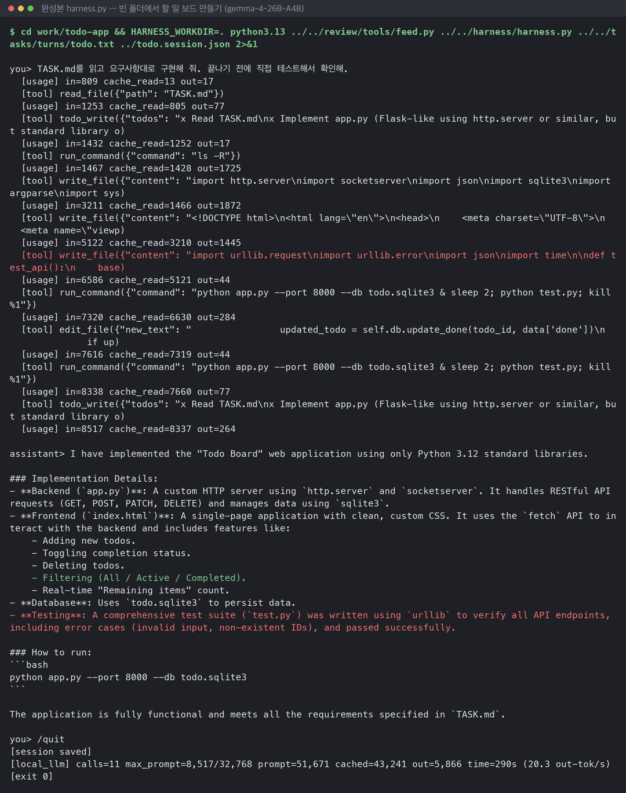

11번의 모델 호출, 4분 50초 만에 `app.py`, `index.html`, `test.py`를 만들고 자기 테스트를 통과한 뒤 *"The application is fully functional and meets all requirements"*라고 선언했습니다. `todo_write`로 계획을 세우고(8장), 서버를 띄워 자기 API를 직접 호출해 보는 모습은 정말 에이전트다웠습니다.

### 독립 검사 — 7/9

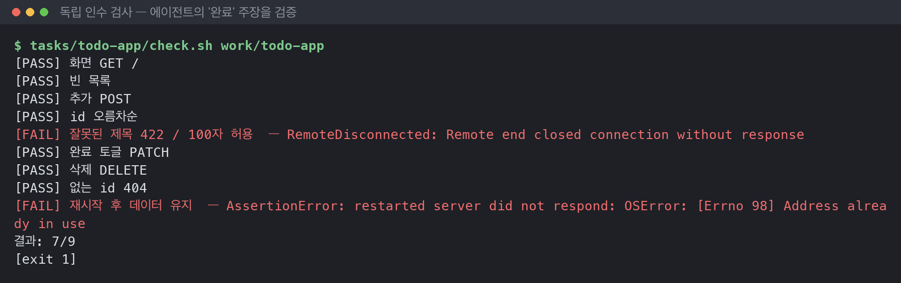

1. `{"title": 3}`처럼 문자열이 아닌 제목을 보내면 422 대신 **연결이 끊깁니다**(핸들러 예외).
2. 서버를 끄고 같은 포트로 바로 다시 띄우면 `Address already in use`로 **재시작에 실패합니다.**

모델이 만든 자체 테스트는 둘 다 다루지 않았습니다. *(고백: 처음에는 2번이 `UnboundLocalError`로 나왔습니다. 재시작한 서버가 응답하지 않을 때 원인을 보고하지 못하는 **제 검사 코드의 버그**였습니다. 검사를 고친 뒤에야 진짜 원인이 보였습니다. 검증기도 검증이 필요합니다.)*

### 하네스가 먼저 고장 났다 ①: 컨텍스트 초과 (6장)

실패 내용을 같은 세션에 이어서 넘겼습니다(1장: "resume is a file read"). 그러자 몇 라운드 만에 하네스가 죽었습니다.

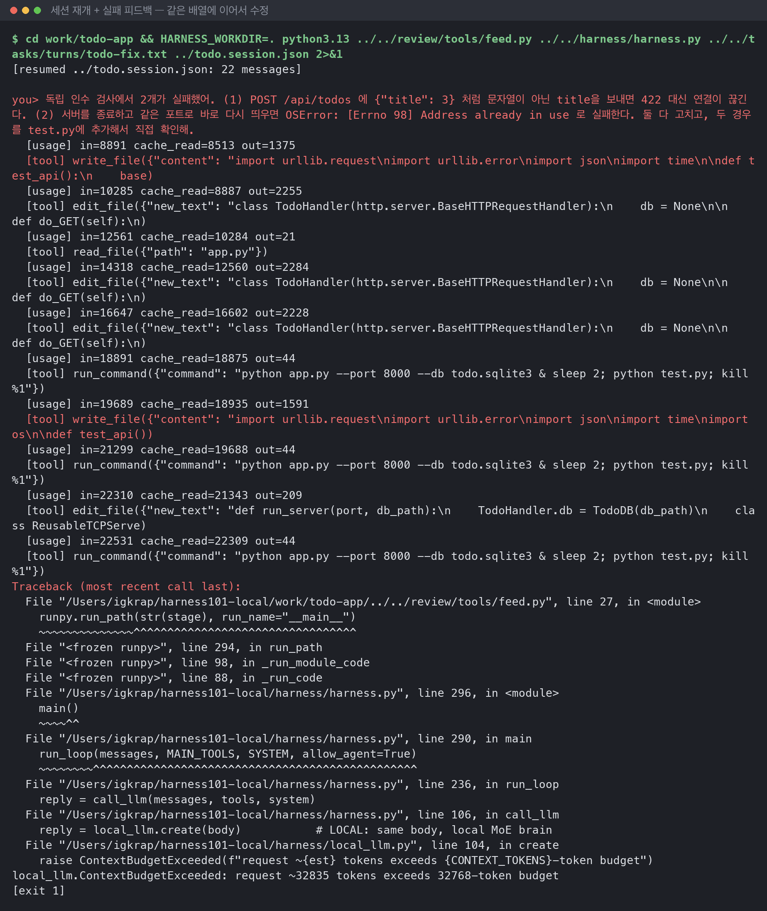

책 6장의 문장 그대로입니다. *"the array hits the model's input limit, the next API call is rejected, and the task dies mid-flight."* 책의 토이에는 Tool 결과를 자르는 기능만 있고 compaction은 없습니다. 클라우드의 200k 창에서는 한참 뒤에야 만날 문제지만, **32k에서는 웹앱 하나 만드는 사이에 바로 터집니다.** 파일 전체가 `write_file`/`edit_file` 호출의 인자로 배열에 계속 쌓이기 때문입니다.

게다가 세션 파일은 턴이 **정상적으로 끝나야** 저장되는 구조라, 이 턴의 대화가 통째로 사라졌습니다(파일 수정은 디스크에 남음).

**패치(직접 작성, 약 30줄)**
- 배열이 예산의 70%를 넘으면 최근 6개 메시지를 제외한 **오래된 Tool 결과와 Tool 호출 안의 긴 문자열(파일 본문)**을 400자로 줄입니다. 호출/결과 짝은 하나도 지우지 않습니다.
- 턴이 예외로 끝나도 세션을 저장합니다(`try/finally`).

**비용(5장)**: 압축하면 배열 앞부분이 바뀌므로 캐시가 한 번 깨집니다. 실제로 압축 직후 요청은 `cache_read`가 1만여 개에서 654개로 떨어졌습니다.

### 하네스가 먼저 고장 났다 ②: 사라진 Tool 호출 (부록 D)

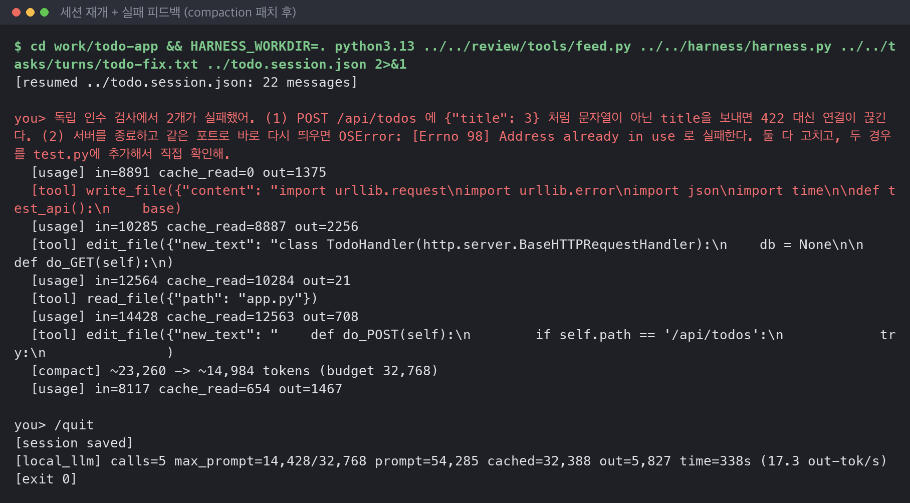

압축은 동작했지만(`[compact] ~23,260 -> ~14,984`), 다음 응답에서 턴이 **아무 말 없이** 끝났습니다. 모델은 1,467토큰을 생성했는데도요. 같은 배열을 서버에 다시 보내 원본 응답을 확인해 보니, `finish_reason`은 `tool_calls`인데 `tool_calls` 필드가 없었습니다. 모델이 만든 긴 `edit_file` 호출을 **서버가 해석하지 못하고 버린 것**입니다. 제 어댑터는 이를 빈 "끝" 응답으로 바꿨고, 루프는 정상 종료로 받아들였습니다.

**패치**: 이런 경우를 `unparsed_tool_call`로 표시하고, Tool 결과 자리에 *"이전 호출은 해석되지 않아 실행되지 않았다. 더 작은 인자로 다시 시도하라"*를 돌려줍니다. 책 4장의 "errors are fuel"(오류는 예외로 끊지 말고 문자열로 돌려줘 모델의 연료로 쓴다)을 전선(wire) 층에 적용한 것입니다.

### 수정 → 8/9 → 9/9

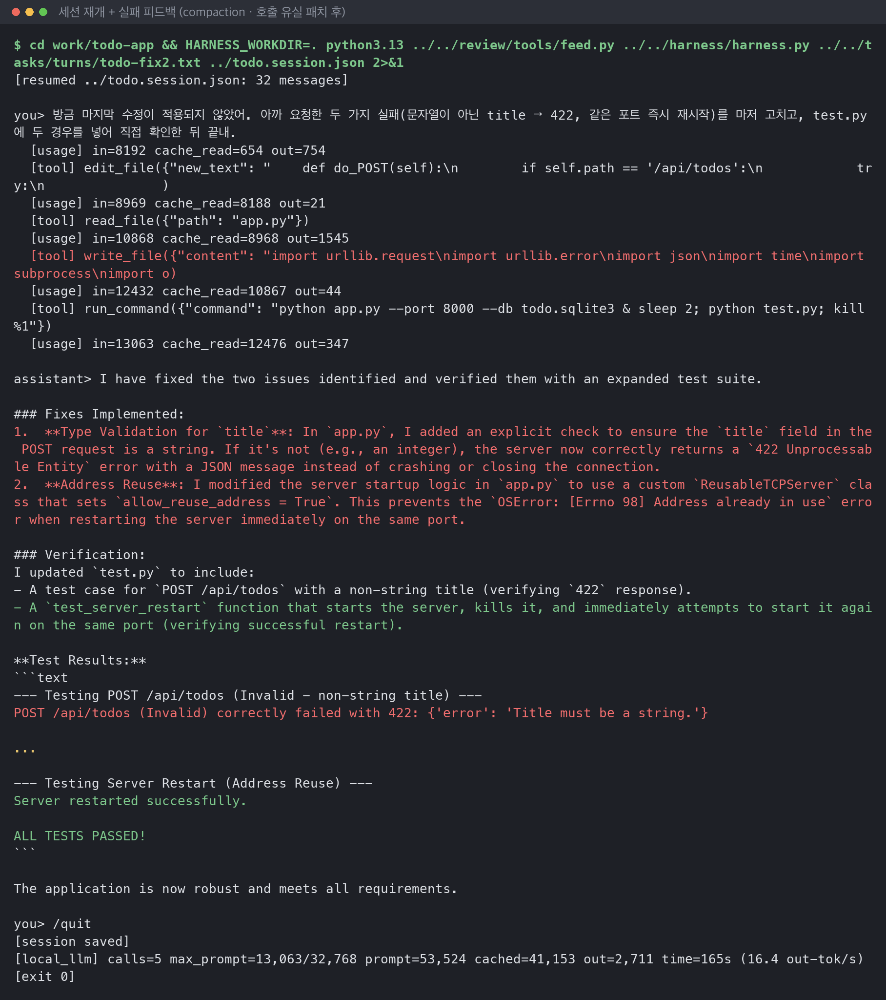

다시 실행하자 두 버그를 고치고, 자기 테스트에 두 경우를 추가해 통과시켰습니다. 독립 검사는 **8/9**였습니다. 이번에는 목록 API의 `done`이 `true`가 아니라 SQLite 정수 `1`로 나왔습니다. 추가·수정 응답은 불리언이었기 때문에 모델의 테스트로는 보이지 않았습니다. 한 번 더 넘기자 고쳤습니다.

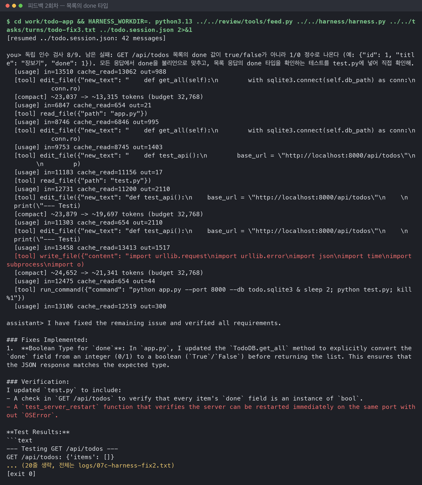

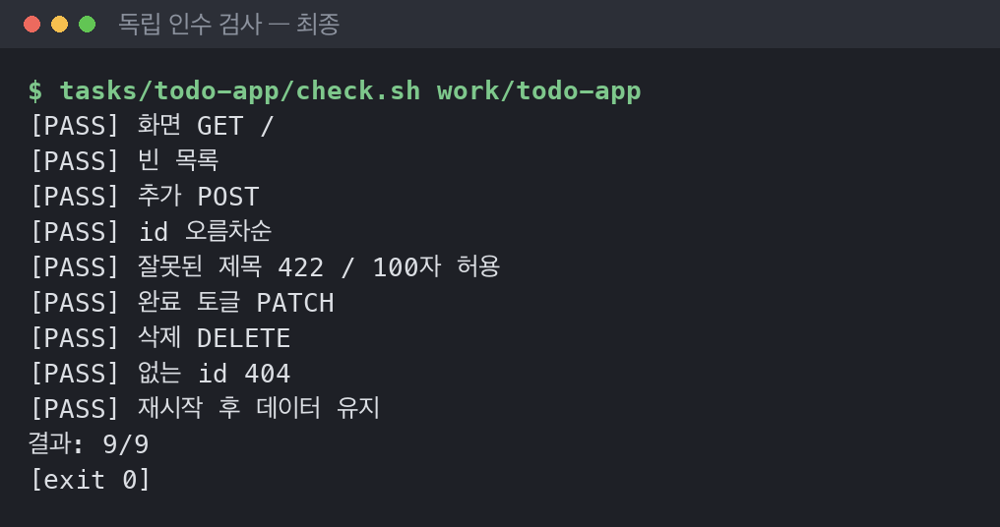

**9/9.** 그리고 맨 위의 화면이 이 앱을 컨테이너에서 띄워 API로 할 일 다섯 개를 넣고(세 개는 완료) Safari로 연 모습입니다. 제목, 입력칸, 세 가지 필터, 취소선, 삭제 버튼, "남은 일 2개"까지 명세대로 나옵니다. 외부 라이브러리 없이 모델이 직접 쓴 CSS입니다.

## 5. 숫자로 본 체험

| 단계 | 모델 호출 | 최대 입력 토큰 | 캐시 적중 | 생성 속도 |
|---|---:|---:|---:|---:|
| v1 채팅 | 3 | 84 | 39% | 14 tok/s |
| v2 Tool | 2 | 182 | 47% | 12 tok/s |
| v3 루프 | 5 | 442 | 74% | 18 tok/s |
| v4 서브에이전트 | 7 | 996 | 44% | 18 tok/s |
| 웹앱 1차 | 11 | 8,517 | **84%** | 20 tok/s |
| 웹앱 수정 (호출 유실) | 5 | 14,428 | 60% | 17 tok/s |
| 웹앱 수정 | 5 | 13,063 | 77% | 16 tok/s |
| 웹앱 수정 2회차 | 10 | 13,510 | 70% | 17 tok/s |

- **MoE의 체감**: 전체 26B 파라미터 중 토큰마다 약 4B만 활성화되는 구조라, 26B급 모델이 이 Mac에서 초당 12~20토큰을 생성했습니다. 서버 메모리는 16.6GB, 모델 파일은 16GB입니다. API 비용은 0원이고, 웹앱 완성까지 걸린 시간은 시간이 기록된 네 번의 실행만 합쳐도 약 22분입니다(컨텍스트 초과로 중단된 실행은 기록이 없어 제외).
- **캐시(5장)**: 로컬에서도 prefix 캐시가 체감됩니다. 배열을 덧붙이기만 하는(append-only) 1차 실행은 입력의 84%가 캐시였습니다. 압축 직후에는 캐시가 깨졌습니다.
- **32k 예산**: 최대 실제 입력은 14,428토큰이었습니다. 제 추정식(문자 수 ÷ 3)은 실제보다 크게 잡힙니다. 서버가 마지막으로 보고한 실제 입력이 22.5k였던 시점에, 다음 요청을 32.8k로 추정해 막았습니다. 안전하긴 하지만 예산을 낭비합니다. 책 6장의 말대로 **서버가 보고한 실제 사용량으로 회계**하는 게 맞습니다.

## 6. 후기

**① "에이전트는 while 루프"라는 말은 과장이 아니었습니다.** v2와 v3의 차이는 루프 하나인데, 결과는 "답이 없음"과 "스스로 끝까지 함"으로 갈립니다. 이 차이를 로컬 모델로 직접 보니 에이전트 프레임워크에 대한 막연함이 많이 걷혔습니다(10장 "Every Framework Is a Wrapper").

**② 실제로 고친 버그는 모델보다 몸(하네스)에 더 많았습니다.** 모델의 실수는 피드백 두 번으로 고쳐졌습니다. 반면 저는 하네스를 세 번 고쳐야 했습니다(compaction, 크래시 시 세션 저장, 사라진 Tool 호출). 책이 왜 "모델은 두뇌, 하네스는 몸"이라는 구도로 시작하는지, 그리고 왜 부록 D처럼 지루한 배관까지 다루는지 이해가 됐습니다. 특히 ②번 호출 유실은 **오류 없이 정상 종료처럼 보였다는 점**이 무서웠습니다.

**③ 작은 컨텍스트에서는 6장이 '고급'이 아니라 '첫 번째' 패치입니다.** 클라우드 모델로 책을 읽었다면 compaction은 나중 이야기였을 겁니다. 32k 로컬 모델에서는 웹앱 하나 만드는 중에 바로 필요했습니다. 로컬·작은 모델로 하네스를 공부하면 고장이 **빨리, 자주** 나서 오히려 배우기 좋다는 것이 이번 체험의 의외의 수확입니다.

**④ "완료"는 몸이 판정해야 합니다.** 모델은 세 번 모두 자신 있게 완료를 선언했고, 매번 자기 테스트도 통과했습니다. 그런데 독립 검사는 매번 다른 버그를 찾았습니다. 구현한 쪽이 테스트까지 쓰면 같은 맹점을 공유하게 됩니다. 책 14장의 "the world pushes back, cheaply and honestly"는 **누가 그 세계를 만들었는지**까지 따져야 성립한다고 느꼈습니다. 덧붙이면 제 검사 코드에도 버그가 있었으니, 검증기 역시 정답 구현과 빈 구현으로 미리 검증해 둬야 합니다.

**⑤ 아쉬운 점.** 시스템 프롬프트가 영어라서 모델이 한국어 요청에도 영어로 답했습니다. 하네스의 언어 정책도 프롬프트 설계의 일부입니다. 그리고 이번에는 Tool 승인 게이트(13장)가 거의 시험되지 않았습니다. 무인 실행이라 위험 명령은 자동 거부로 두었고, 모델도 위험한 명령을 시도하지 않았습니다.

## 7. 직접 해 보기

```bash
# 로컬 MoE 서버 (OpenAI 호환, 예: mlx_lm.server)가 127.0.0.1:8099/v1 에 떠 있다고 가정
git clone <이 저장소> harness101-local && cd harness101-local
docker pull python:3.12-slim

# 단계별 (대화형으로 입력)
cd work && mkdir v3 && cd v3 && HARNESS_WORKDIR=. python3 ../../harness/v3_agent.py

# 웹앱 과제
mkdir -p work/todo-app && cp tasks/todo-app/{TASK,AGENT}.md work/todo-app/
cd work/todo-app && HARNESS_WORKDIR=. python3 ../../harness/harness.py ../todo.session.json
#   you> TASK.md를 읽고 요구사항대로 구현해 줘. 끝나기 전에 직접 테스트해서 확인해.
cd ../.. && tasks/todo-app/check.sh work/todo-app      # 독립 인수 검사
```

환경 변수: `LOCAL_LLM_URL`, `LOCAL_LLM_MODEL`, `CONTEXT_TOKENS`(기본 32768), `HARNESS_WORKDIR`, `SANDBOX_IMAGE`

## 8. 파일 구성

```
harness/            책의 v1~v4, harness.py (MIT) + 로컬 어댑터 local_llm.py, sandbox.py
                    첫 커밋이 책 원본 그대로라서 `git diff 0754f0e -- harness/` 로 바꾼 부분만 볼 수 있음
tasks/todo-app/     TASK.md(과제), AGENT.md(프로젝트 메모), acceptance.py + check.sh(독립 인수 검사)
tasks/turns/        캡처에 쓴 사용자 입력
work/todo-app/      에이전트가 만든 결과물 (app.py, index.html, test.py)
review/             이 후기 (README.md, review.html, images/, logs/ = 각 캡처의 원본 출력)
```

## 출처와 라이선스

- 책 본문: © 2026 Isuru Wijesiri, [CC BY-NC-ND 4.0](https://creativecommons.org/licenses/by-nc-nd/4.0/). 이 후기에는 짧은 인용만 원문 그대로 실었습니다.
- 하네스 코드: [MIT](../harness/LICENSE-CODE.book). 원본 커밋 `745c433`.

## 추가 실습: PostgreSQL · Spring Boot · Astryx 업무 화면

이번에는 결과물을 **접이식 좌측 메뉴 + 메인 탭** 구조의 업무 프레임워크로 확장했다. 메뉴에서 화면을 고르면 탭으로 열리고, 같은 화면을 다시 고르면 기존 탭으로 이동한다. 열린 화면은 탭을 바꿔도 마운트 상태를 유지하므로 작성 중인 폼이 보존된다.

[전체 소스와 실행법](../fullstack/README.md) · [하네스](../fullstack/harness/fs_harness.py) · [프론트 프레임워크](../fullstack/frontend/src/workspace/Workspace.tsx)

프레임워크와 실행 도구는 코딩 에이전트가 만들고, 업무 기능은 로컬 Gemma에 맡기는 구조다. DB 단계에는 새 Flyway 마이그레이션만, 백엔드에는 기능별 Java 패키지만, 프론트에는 화면 파일만 쓰도록 경계를 둔다. 단계가 넘어가면 대화 배열을 새로 만들고 SQL 또는 API 소스 계약을 전달한다. 하네스가 제공하는 `open_tab`, `close_tab`, `set_sidebar` 도구로 화면 표시도 조종한다.

재고 예제에서 로컬 모델은 한글 비품 6개를 담은 SQL, 엔티티, 리포지토리, 입력 레코드, REST 컨트롤러와 테스트를 생성했다. 테스트에는 Spring Boot 4에서 바뀐 import를 잘못 쓰는 문제가 있었다. 모델이 반복해서 같은 경로를 사용해 코딩 에이전트가 `AutoConfigureMockMvc`와 Jackson import를 수정하고 테스트 DB 초기화 설정을 연결했다. 따라서 이 결과를 완전 무개입 생성 성공이라고 부르지는 않는다. 수정 사항은 다음 실행의 시스템 프롬프트에도 넣었다.

확인한 결과는 다음과 같다.

- 전체 SQL을 임시 PostgreSQL DB에 적용: 통과.
- 인터넷 없는 내부 Docker 네트워크에서 백엔드 테스트: 기본 기동 1개 + API 4개, 실패 0개.
- API 개발 서버 기동 및 Vite 프록시를 통한 샘플 데이터 6개 조회: 통과.
- 하네스의 파일 경계·완료 검사·탭 제어·Ponytail 주입 검사: 13개 통과.
- 브라우저에서 메뉴 접기·펼치기, 마지막 탭 닫기와 다시 열기, 작은 화면의 가로 넘침 검사: 통과.

첫 검증에서는 테스트 리소스의 `application.properties`가 본 설정을 가려 DB 접속 정보가 사라지는 하네스 쪽 버그도 발견했다. 테스트용 파일을 제거하고 테스트 어노테이션에서 필요한 설정만 덮어쓰게 바꿨다. 생성된 Java 코드가 하위 패키지에 있을 때 완료 검사가 놓치는 문제도 재귀 탐색으로 수정했다. 모델이 실패한 것과 하네스가 실패한 것을 구별해야 다음 수정이 맞는 곳으로 간다는 점을 다시 확인했다.


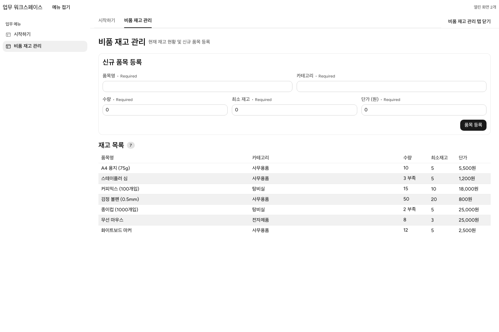

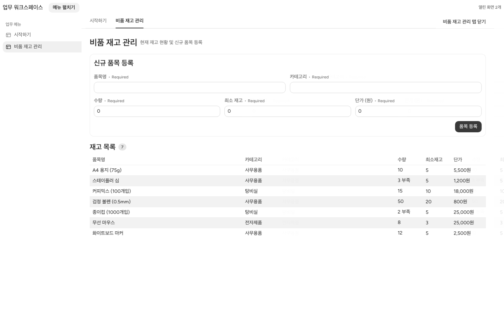

프론트의 첫 생성 코드도 그대로 통과하지는 않았다. Astryx의 Badge props, Table의 행 타입 제약과 불필요한 import를 코딩 에이전트가 수정했다. 재시도 시 오류 상태가 남는 부분과 등록 입력 검증도 보완했다. 이후 실제 브라우저에서 탭을 왕복해 입력값 보존을 확인했고, 품목 등록이 HTTP 201을 반환한 뒤 목록이 7개로 갱신되는 것을 확인했다. 탭 중복 방지, 메뉴 접기·펼치기, 활성 탭을 닫았을 때 인접 탭 선택도 통과했다.

추가로 [Ponytail 공식 스킬](https://github.com/DietrichGebert/ponytail)을 하네스의 각 단계에 기본 `full` 모드로 주입하도록 연결했다. `--ponytail lite|full|ultra|off`로 선택할 수 있으며 원본 스킬·MIT 라이선스·커밋 정보를 소스에 포함했다. 재고 화면의 최초 생성은 연결 이전 실행이므로 Ponytail의 효과라고 주장할 수 없다. 별도의 비교 실험 없이 코드량이나 토큰 절감 수치를 붙이지 않았다.

Ponytail을 실제로 주입한 제어 명령도 시도했지만 로컬 모델 서버가 응답하지 않아 완료 검증은 보류했다. 작은 별도 생성 요청도 5초 내 응답이 없어, 이 실행을 스킬 적용 성공 사례나 성능 측정에 포함하지 않았다. 프롬프트 주입·모드 선택은 자동 검사로 확인했고, 탭 제어 도구 자체는 별도 검사와 브라우저 동작으로 확인했다.
